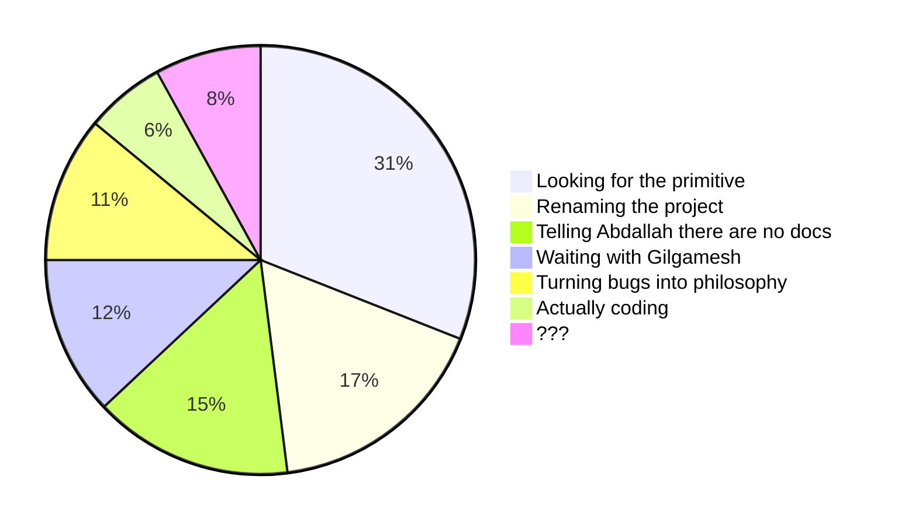
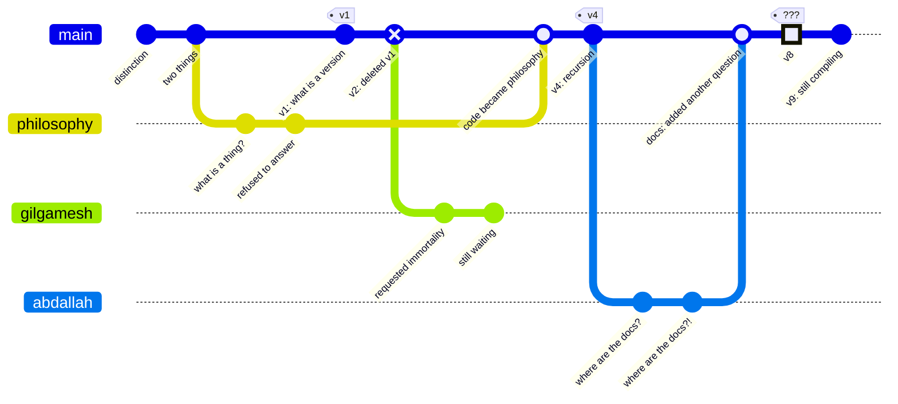

### Alam Malia · MORCELAGOX
*philosopher with a compiler · vibe coder with questions*
*I have not resolved the problem. I have made the problem interactive.*

---

### `> boot sequence`

### `> three angles, not three products`

| | Project | Claims to be | Actually is | Status |
|:-:|---|---|---|---|
| 🌌 | [**Maragram**](https://github.com/MORCELAGOX/maragram) | Messages as space, not a timeline | Telegram, standing in a field, confused |  |
| ♾️ | [**FARA**](https://github.com/MORCELAGOX/fara) | Possibility → distinction → structure | An argument that compiles |  |
| 🪞 | [**Second Mind**](https://github.com/MORCELAGOX/second-mind) | Your own data as an explorable surface | Not your doctor. A mirror with zoom. |  |

### `> stats nobody asked for`

### `> where my time goes`

### `> git log --graph --reality`

* the `gilgamesh` branch has never been merged. it has been waiting for 4,000 years. please do not delete it.

### `> searching for the primitive`

### `> open issues (∞)`

- [ ] **#1** Gilgamesh is still waiting for immortality · `wontfix` `needs-a-god`
- [ ] **#2** Abdallah asked where the documentation is · `duplicate of #2`
- [ ] **#3** `npm install meaning` returns 404 · `upstream`
- [ ] **#4** Observer detected. Observer is the observed. · `cannot reproduce without observing`
- [ ] **#5** The universe has no issue tracker · assigned to myself
- [x] **#6** Production is philosophically unstable · `works as intended`
- [x] **#7** Coffee has no ontology · `closed: drank it`

### `> do not open`

do not open

 

I said do not open.

fine. the manifesto.

 

> First there was distinction. Then there were two things.
> Then someone asked what a thing is. I refused to answer.
> Composition appeared anyway. Reduction started eating composition.
> Recursion watched from the corner.
>
> `space > timeline` · `relation > sequence` · `question > answer` · `reality > model` · `model < reality < ???`

the primitive is in here

 

it was not. try the next one.

the primitive before the primitive

 

Gilgamesh is in here. He is not impressed. He asks if you have seen immortality.

the definition

 

## `???`

The definition was deleted.
You opened five boxes to find a question.
That was the experiment. Thank you for participating.

exit code 0 · meaning undefined

---

this README recurses · please do not trust the system · continue█

