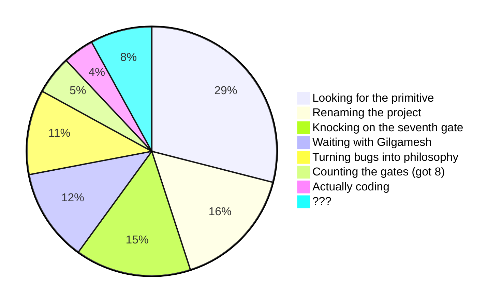
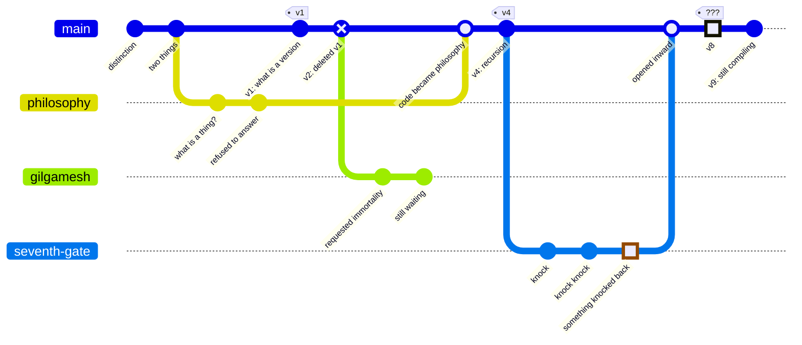

<div align="center">




### Alam Malia · MORCELAGOX
*philosopher with a compiler · vibe coder with questions*
*I have not resolved the problem. I have made the problem interactive.*

[**📜 read the absurd CV**](CV.md) · [**🚪 enter the seven gates**](#-the-seven-gates)

</div>



### `> boot sequence`




### `> three angles, not three products`

| | Project | Claims to be | Actually is | Status |
|:-:|---|---|---|---|
| 🌌 | [**Maragram**](https://github.com/MORCELAGOX/maragram) | Messages as space, not a timeline | Telegram, standing in a field, confused |  |
| ♾️ | [**FARA**](https://github.com/MORCELAGOX/fara) | Possibility → distinction → structure | An argument that compiles |  |
| 🪞 | [**Second Mind**](https://github.com/MORCELAGOX/second-mind) | Your own data as an explorable surface | Not your doctor. A mirror with zoom. |  |


### `> stats nobody asked for`




### 🚪 the seven gates




<div align="center"><sub>it is said that something exists behind the seventh gate. it is also said that it is said.</sub></div>

<details>
<summary><b>GATE I</b> · the gate of the timeline</summary>
<br>

> **toll:** your chronology
> **inscription:** *what came first came first only because you were counting.*

The guard takes your timeline. Your memories are now places instead of dates.
Gilgamesh is standing here. He refuses to pay. He has been refusing for 4,000 years.

<details>
<summary><b>GATE II</b> · the gate of the name</summary>
<br>

> **toll:** your name
> **inscription:** *you may keep the vowels.*

You are now `???`. The guard is also `???`. You get along surprisingly well.

<details>
<summary><b>GATE III</b> · the gate of definitions</summary>
<br>

> **toll:** every definition you brought
> **inscription:** *a word is a fence. we took the fence. the field is still there.*

The guard reads you the dictionary backwards. Halfway through, it starts making sense.
That is the dangerous part.

<details>
<summary><b>GATE IV</b> · the gate of the README</summary>
<br>

> **toll:** this README
> **inscription:** *documentation was never real. it was a long loading screen.*

You are now reading a README that has already been taken.
Please continue as if nothing happened.

<details>
<summary><b>GATE V</b> · the gate of the observer</summary>
<br>

> **toll:** the observer
> **inscription:** *nobody is watching. something is.*

If you can still read this, someone else is reading it for you.
Do not look behind you. There is no behind. Gate I took it.

<details>
<summary><b>GATE VI</b> · the gate of the last question</summary>
<br>

> **toll:** your last question
> **inscription:** *every answer is a question that stopped moving.*

The guard takes your last question and gives you a smaller one, still warm:

```
?
```

<details>
<summary><b>GATE VII</b> · the gate that opens inward</summary>
<br>

> **toll:** nothing. there is nothing left. it takes that too.
> **inscription:** *inward of what?*

The door opens inward. You step through. Behind the seventh gate there is:

```
???
```

and a note taped to it:

> *back in 5 minutes.*
> — dated 2100 BC

<details>
<summary><b>GATE VIII</b> · there is no gate VIII</summary>
<br>

You were told there were seven.
Close this. Count the gates again. You will get seven.
You opened eight.

<sub>the sigil blinked. that was the answer.</sub>

</details>
</details>
</details>
</details>
</details>
</details>
</details>
</details>


### `> where my time goes`



### `> git log --graph --reality`


<sub>* the `gilgamesh` branch has never been merged. it has been waiting for 4,000 years. please do not delete it.</sub>


### `> searching for the primitive`



### `> open issues (∞)`

- [ ] **#1** Gilgamesh is still waiting for immortality · `wontfix` `needs-a-god`
- [ ] **#2** The seventh gate opens inward. Inward of what? · `needs-triage`
- [ ] **#3** `npm install meaning` returns 404 · `upstream`
- [ ] **#4** Observer detected. Observer is the observed. · `cannot reproduce without observing`
- [ ] **#5** Someone counted eight gates · `duplicate of #5`
- [ ] **#6** The universe has no issue tracker · assigned to myself
- [x] **#7** Production is philosophically unstable · `works as intended`
- [x] **#8** Coffee has no ontology · `closed: drank it`


<div align="center">


<sub>this README recurses · please do not trust the system · [the CV is worse](CV.md) · continue█</sub>

</div>
